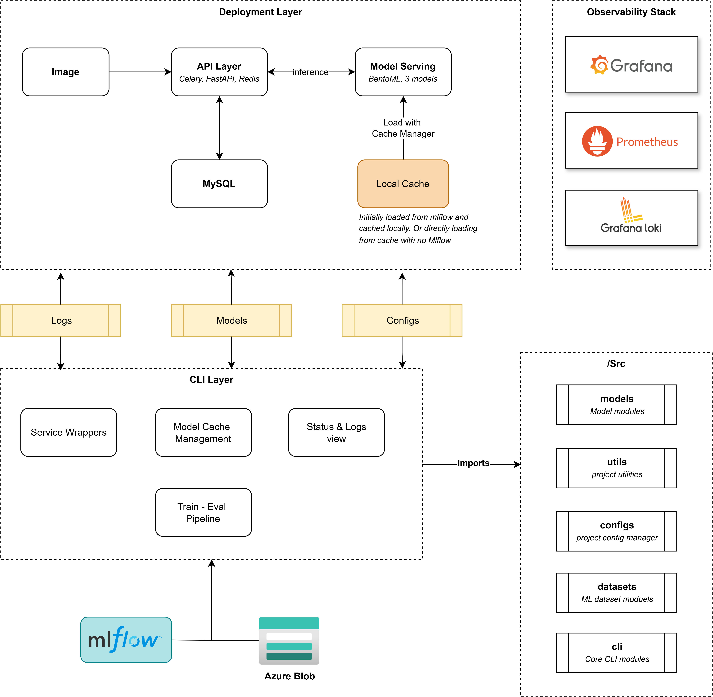

#  Galaxy Classification
 
[](https://github.com/YubikNakarmi/galaxy-classification/actions/workflows/docs.yml)
 
An end-to-end MLOps pipeline for classifying galaxy morphologies from images, built with PyTorch, FastAPI, and BentoML — with full experiment tracking, data versioning, and observability baked in.

> Full documentation is available at the [docs site](https://github.com/YubikNakarmi/galaxy-classification), generated via MkDocs and deployed automatically on push.

>Model available at [Hugging Face](https://huggingface.co/YubikNakarmi/GalaxyZooCNN)
---
 
## Table of Contents

 
- [Galaxy Classification](#galaxy-classification)
  - [Table of Contents](#table-of-contents)
  - [Movitation](#movitation)
  - [Tech Stack](#tech-stack)
  - [Architecture](#architecture)
  - [models](#models)
  - [Running](#running)
  - [Getting Started](#getting-started)
    - [Prerequisites](#prerequisites)
    - [File Setup](#file-setup)
    - [DVC Setup (Optional)](#dvc-setup-optional)
    - [Azure Blob Setup (Optional)](#azure-blob-setup-optional)
  - [Database Migrations](#database-migrations)
  - [CLI](#cli)
  - [Training \& eval](#training--eval)
    - [Training on a VM](#training-on-a-vm)
    - [Eval](#eval)
  - [Testing](#testing)
  - [Azurite (Local Blob Emulator) Testing](#azurite-local-blob-emulator-testing)
  - [Roadmap / Known Improvements](#roadmap--known-improvements)
  - [Sources / References](#sources--references)
  
---


## Movitation
The reason for me working of project is due to multitude of factors. Firstly, I was always interested in astronomy and Neural networks and I wanted to buiild something regarding Astronomy. Then there also the motivation to build something better than my lat project [AQI_predictor](https://github.com/YubikNakarmi/Aqi_predictor), which is pretty messy. I wanted to contiune to learn to build better systems wich more cleaner and maintainable code with also better organizations and potability. 

With as miminal use of AI as possible, except is somethign like comments, docstrings or documentation .Lastly, I also wanted to learn new tools for DevOPS, Mlops, and ML in general I leared tools like:
- Pytorch
- FastAPI
- BentoML
- Promethus
- Grafana
- Alembic
- Kuberentes
and more


## Tech Stack
 
| Layer            | Tools |
|-------------------|-------|
| Modeling           | PyTorch |
| Data & Pipeline Versioning | DVC |
| Experiment Tracking | MLflow |
| Serving            | FastAPI, BentoML |
| Observability      | Prometheus, Grafana, Loki |
| Infrastructure     | Terraform, Azure, Docker / Docker Compose, Kuberentes |
| Docs               | MkDocs |
| cli                 | Click, Rich |

## Architecture


## models
- Default: default 5-class residual CNN. 
- Dirichlet: voting ratio-based model with Dirichlet NLL loss and multi-head output with the same backbone as default. 
## Running

The project itself is build using microservice architecture. The project is divided into 3 main services:
- **Training Service**: This service is responsible for training the model. It uses PyTorch for model training and DVC for data versioning. It also tracks experiments using MLflow.
- **Serving Service**: This service is responsible for serving the trained model. It uses FastAPI and BentoML for serving the model. It also exposes metrics for Prometheus and Grafana.
- **inference Service**: This service is responsible for making predictions using the trained model. It uses FastAPI and BentoML for serving the model. It also exposes metrics for Prometheus and Grafana.

!!! Note 
    There are also other serverices but these 3 are main services. 

`docker-compose.yml` is provided to run the services locally. You can run the services using the following command:

```sh
docker-compose up #runs all which might not be necessary
```

## Getting Started

### Prerequisites
 
- Python (see `pyproject.toml` / `uv.lock` for the pinned version)
- [uv](https://docs.astral.sh/uv/) for dependency management
- Docker & Docker Compose (for local infra)
- An Azure Storage Account (or [Azurite](https://github.com/Azure/Azurite) for local emulation)

**Using uv**
```bash
uv sync --all-extras --frozen # for all deps

uv sync --api # for api deps only
```

**With pip**
```bash
pip install -r requirements.txt
```


### File Setup
 
Create the following directories at the project root and add `.gitkeep` files to each, so they're tracked by git before any real data lands in them:
 
```sh
mkdir -p logs models data
touch logs/.gitkeep models/.gitkeep data/.gitkeep
```
 
### DVC Setup (Optional)
 
Initialize DVC and configure an Azure remote for data/model versioning:
 
```sh
dvc init
 
# Upload a file directly to blob storage (one-off)
az storage blob upload \
  --account-name <storage_account_name> \
  --container-name <container_name> \
  --name <blob_name> \
  --file <file_path>
 
# Track a file with DVC
dvc add <file_path>
 
# Configure the Azure remote
dvc remote add -d azure_remote azure://<container_name>
dvc remote modify azure_remote account_name <storage_account_name>
 
# Authenticate — pick one:
dvc remote modify azure_remote --local connection_string "DefaultEndpointsProtocol=https;AccountName=<storage_account_name>;AccountKey=<storage_account_key>;EndpointSuffix=core.windows.net"
# or
dvc remote modify azure_remote sas_token <generated_sas_token>
```
 
### Azure Blob Setup (Optional)
 
1. Create a storage account in Azure (or use **Azurite** for local emulation).
2. Create the required containers within that account.
3. Generate a SAS token or connection string for authentication.
**Required containers:**
 
| Container | Purpose |
|---|---|
| `dvc-storage` | DVC remote storage |
| `mlflow` | MLflow tracking backend |
| `galaxy-classification-experiments` | Experiment artifacts |
| `galaxy-classification-logs` | Application/training logs |
 
## Database Migrations
 
Migrations are managed with Alembic:
 
```sh
alembic upgrade head
```

## CLI 

### Importing a model 
Model can be found on the huggingface site. 

```sh
galax cache import --model-path <path_to_model> --variant <variant_name>
```
## Training & eval
 
### Training on a VM
 
For GPU training on a remote VM (e.g., Azure), make sure `nvidia-smi` is available, then install the CUDA-enabled PyTorch build:
 
```sh
pip uninstall torch torchvision -y
pip install torch torchvision --index-url https://download.pytorch.org/whl/cu121
```
 
To forward the MLflow UI from the VM to your local machine:
 
```sh
ssh -i .\test-vm_key.pem -L 5000:localhost:5000 azureuser@<vm-ip>
```

Run training script:

```sh
galax pipeline train --variant <variant_name> --run-eval=True
```
### Eval
Eval requires run id
 
> **Current model:** ~61.2M parameters (61,187,525).
 
## Testing
 
```sh
# Run a single test module
pytest tests/test_checkpoint_manager.py
 
# Run integration tests
pytest -m integration -v
```
 
## Azurite (Local Blob Emulator) Testing
 
You can validate blob storage integration locally against [Azurite](https://github.com/Azure/Azurite) without touching real Azure resources:
 
```python
from src.utils.azure_utils import AzureBlobStorage
 
blob = AzureBlobStorage(
    storage_connection_string=(
        "DefaultEndpointsProtocol=http;"
        "AccountName=devstoreaccount1;"
        "AccountKey=Eby8vdM02xNOcqFlqUwJPLlmEtlCDXJ1OUzFT50uSRZ6IFsuFq2UVErCz4I6tq/K1SZFPTOtr/KBHBeksoGMGw==;"
        "BlobEndpoint=http://127.0.0.1:10000/devstoreaccount1;"
    )
)
 
blob.container_name = "test"
blob.print_info()
```
 
## Roadmap / Known Improvements
 
- **Improved API** - Update api with auth and history, the foundation is already set for these.
- **Kuberentes** - Currently has kuberentes features, but isn't properly tested and fully implemented.
- **Full trainin** - Currently model is not run for full epoch I only picked around 30 epoch, because of convergence at those epochs.
- **LGTM** - Currently have loki, grafana & prometheus but not fully implemented. 
- **Model cache resilience** — the BentoML model loader cache should fall back to the most recent locally cached "best" model (or pull directly from blob storage) if MLflow is unreachable.
- **Model caching** — cache the loaded model instead of reloading it on every request.
- **Config validation** — validate config paths upfront at startup rather than validating separately per training run.
- **more variants** — add more model variants to experiment with, including larger models and different architectures.
- **multi format loading from cache**- currently cache only handles the .pt format doesnt support other forats like .onnx, .tflite, .torchscript. But you can export the with cli. 

## Sources / References
- [Draw.io](https://drive.google.com/file/d/1SV51fyxewgoo_lKwKIzrzTUg28_-nhWQ/view?usp=sharing) for building architecture diagrams
- [Galaxy Zoo dataset](https://data.galaxyzoo.org)
- [Galaxy Morphology Classification with Deep Convolutional Neural Networks](https://arxiv.org/abs/1807.10406)
