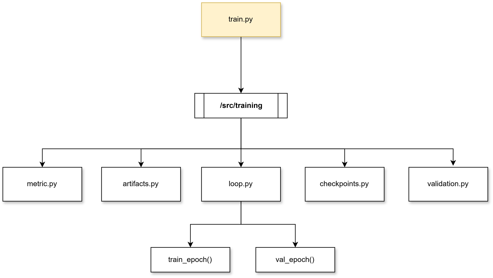

j## Codebase architecture
For this project structure I clearly seperated custom modules with top level wrappers. For example on training script on [train.py](/ml/pipeline/train.py), the source code logic is on `/src/training/` dir The diagram belows shows a tree view for this.

`train.py`utilizes all the downstream dependancies used for training. However, the above diagram doesn't show the full methods and classes used by other files other than loop.py.

Similarly most of the project is shaped like this, the files outside of the `/src` mostly wraps or depends on the source files. Another prominent example might be the CLI which solely depends on `/src/cli` for CLI related styling and logic. The more information about that is on [CLI](../development/cli.md
) page. 