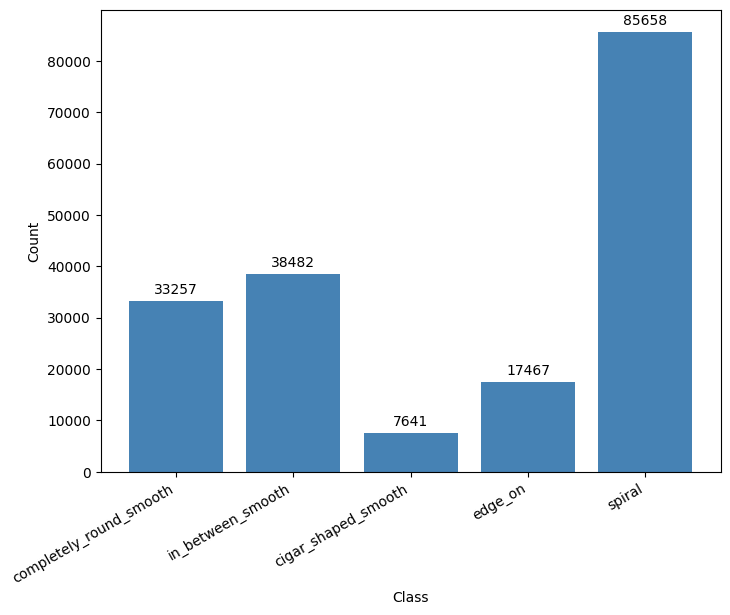
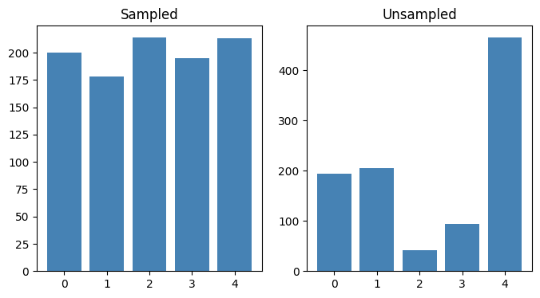

# Weighted Sampling

## Class Distribution
### Class Table

| Class | Clean Sample | $N_{\text{sample}}$ |
|:-----:|:-------------|--------------------:|
| 0 | Completely round smooth | 33257 |
| 1 | In-between smooth | 38482 |
| 2 | Cigar-shaped smooth | 7641 |
| 3 | Edge-on | 17467 |
| 4 | Spiral | 85658 |

{align="center" width="60%"}
/// caption
 Class distribution for Method 1 without sampling
 ///
The class distribution is highly imbalanced, with Class 4 (Spiral) being the most populous and Class 2 (Cigar-shaped smooth) being the least populous. This imbalance may affect model training and evaluation, necessitating techniques such as class weighting or resampling to mitigate bias towards the majority class.

## Balancing Using Class Weights
Class balacing using pytorch's WeightedRandomSampler. The weights are computed as the inverse of the class frequencies, giving more importance to minority classes during training.

{align="center" width="80%"}

/// caption
Figure 2: Class weights for Method 1 for 1k samples
///
To address the class imbalance, we can compute class weights inversely proportional to the class frequencies. This allows the model to give more importance to minority classes during training, potentially improving performance on underrepresented classes.

## Criterion
U