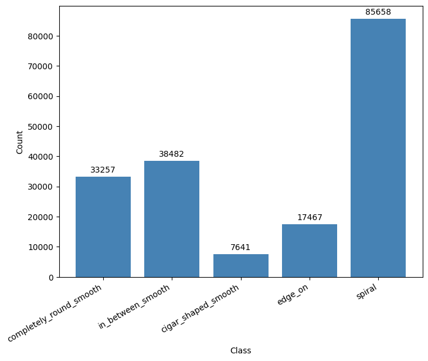

# Label Processing
In this section, I will discuss different methods of label processing on Galaxy Zoo 2 dataset used in this project. The dataset contains 11 columns of labels, each representing a different morphological feature of galaxies. The labels are in the form of probabilities, indicating the likelihood of a galaxy having a particular feature.

## Method 1 (Zhu et al., 2019)
### Thresholding Overview
Using thresholds for galaxy classification based on voting by [Zhu et al., 2019](https://arxiv.org/abs/1807.10406)

### Class Definitions

| Class | Clean Sample | Tasks | Condition 1 | Condition 2 | Condition 3 (Guard) | Condition 4 | $N_{\text{sample}}$ |
|:-----:|:-------------|:------|:------------|:------------|:--------------------|:------------|--------------------:|
| 0 | Completely round smooth | T01 + T07 | $f_{\text{smooth}} \geq 0.469$ | $f_{\text{completely round}} \geq 0.50$ | $f_{\text{features/disk}} < 0.430$ | T07 argmax | 33257 |
| 1 | In-between smooth | T01 + T07 | $f_{\text{smooth}} \geq 0.469$ | $f_{\text{in-between}} \geq 0.50$ | $f_{\text{features/disk}} < 0.430$ | T07 argmax | 38482 |
| 2 | Cigar-shaped smooth | T01 + T07 | $f_{\text{smooth}} \geq 0.469$ | $f_{\text{cigar-shaped}} \geq 0.50$ | $f_{\text{features/disk}} < 0.430$ | T07 argmax | 7641 |
| 3 | Edge-on | T01 + T02 | $f_{\text{features/disk}} \geq 0.430$ | $f_{\text{edge-on, yes}} \geq 0.602$ | $f_{\text{smooth}} < 0.469$ | — | 17467 |
| 4 | Spiral | T01 + T02 + T04 | $f_{\text{features/disk}} \geq 0.430$ | $f_{\text{edge-on, no}} \geq 0.715$ | $f_{\text{spiral, yes}} \geq 0.619$ | $f_{\text{smooth}} < 0.469$ | 85658 |

---

### T07 Argmax Rule (Classes 0–2)

Among $f_{\text{completely round}}$, $f_{\text{in-between}}$, and $f_{\text{cigar-shaped}}$, assign the class with the highest vote fraction, provided:

$$\max(f_{\text{completely round}},\ f_{\text{in-between}},\ f_{\text{cigar-shaped}}) \geq 0.50$$

If the maximum falls below $0.50$, the sample is **dropped** as ambiguous.

---

### Exclusivity Guard Logic

The top-level branch is determined by a strict `if/elif` on T01:

$$
\text{Branch} =
\begin{cases}
\text{Smooth (Classes 0--2)} & \text{if } f_{\text{smooth}} \geq 0.469 \text{ and } f_{\text{features/disk}} < 0.430 \\
\text{Disk (Classes 3--4)}   & \text{if } f_{\text{features/disk}} \geq 0.430 \text{ and } f_{\text{smooth}} < 0.469 \\
\text{Drop (ambiguous)}      & \text{otherwise}
\end{cases}
$$

### Class Distribution
{align="center" width="60%"}
/// caption
The class distribution is highly imbalanced, with Class 4 (Spiral) being the most populous and Class 2 (Cigar-shaped smooth) being the least populous. This imbalance may affect model training and evaluation, necessitating techniques such as class weighting or resampling to mitigate bias towards the majority class.
///

## Method 2: Using Hubble's Classification
### Overview