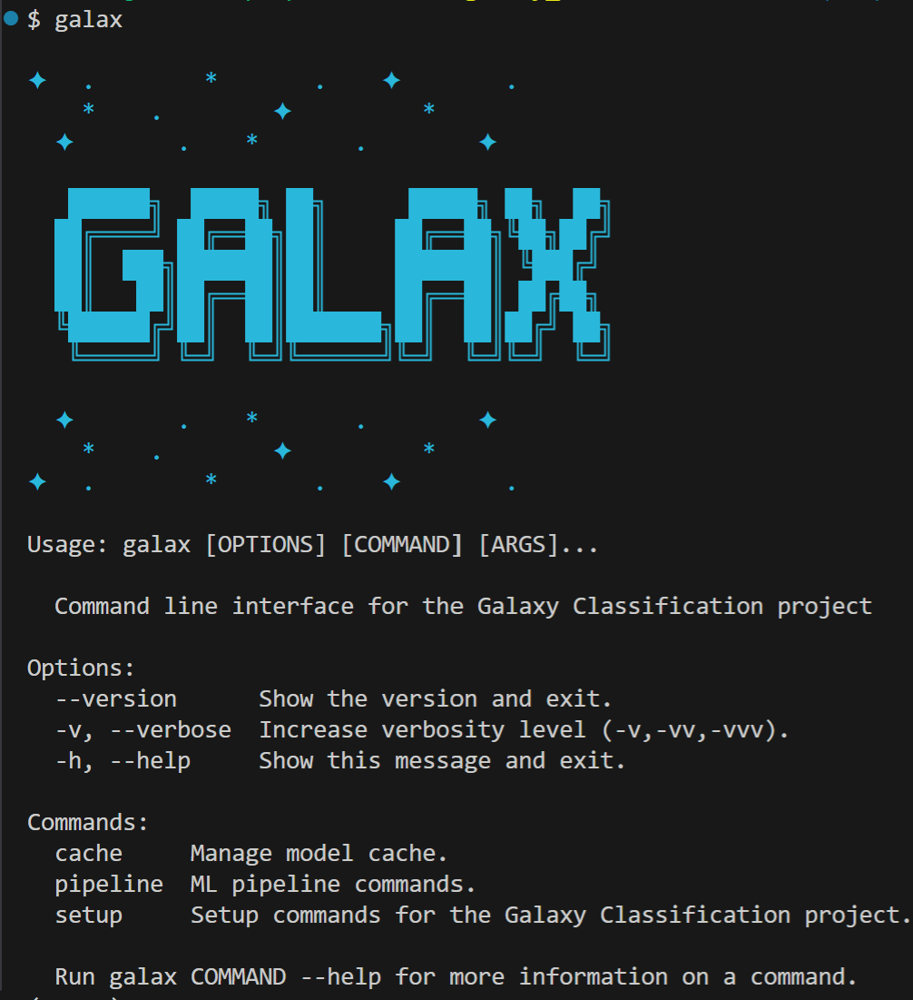
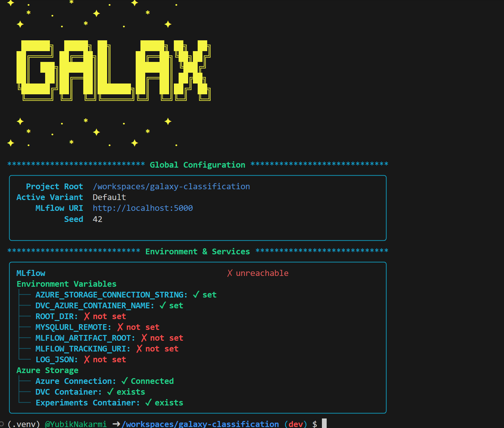
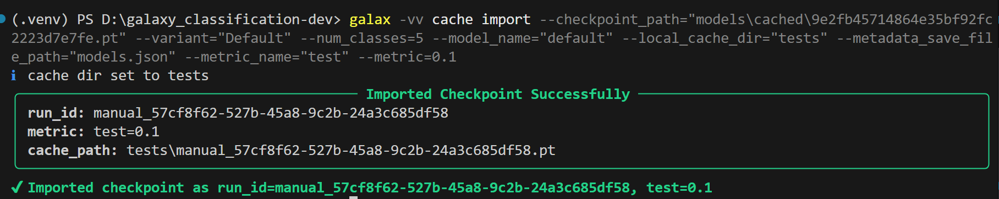
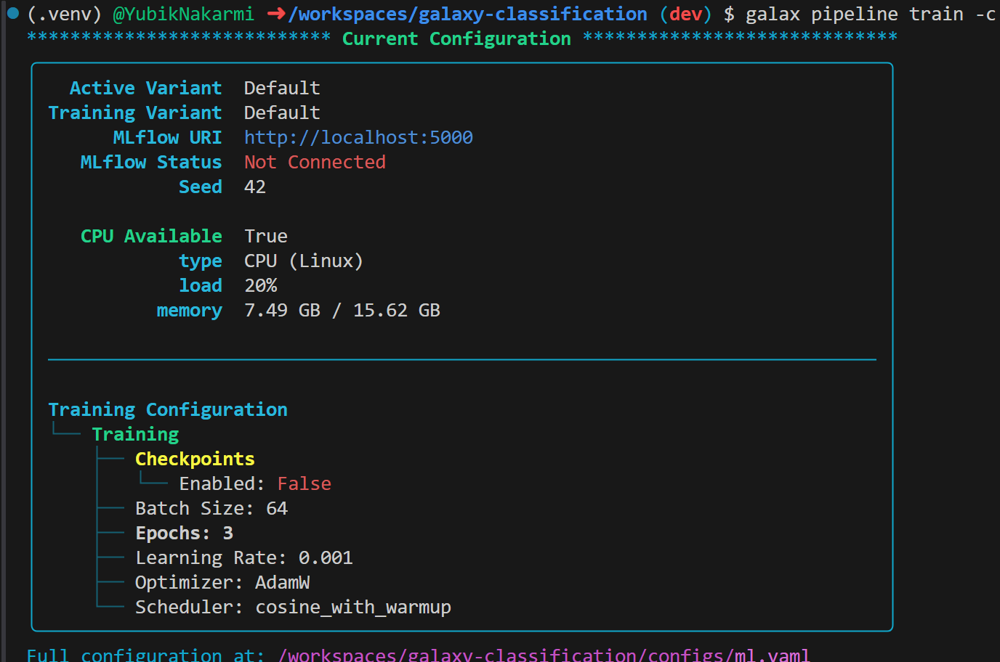
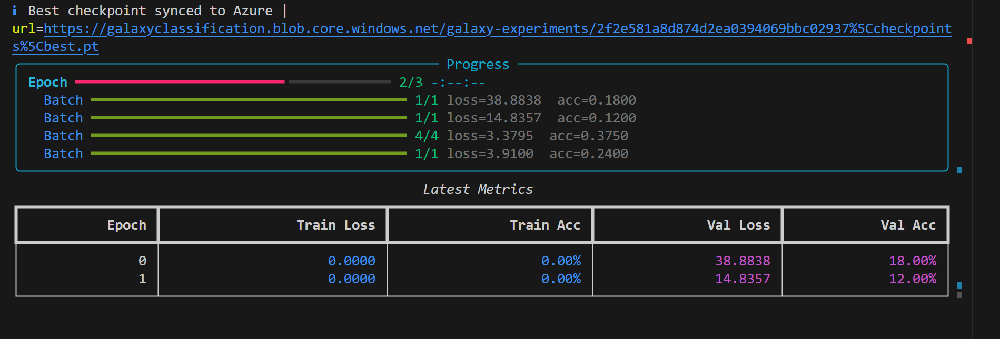
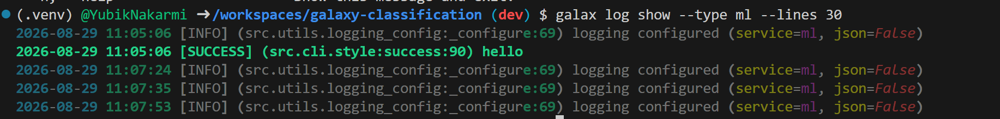

## Intro

!!! Warning
    To be able to use CLI you need to install the editable pacakge of use uv. Also ensure that you have virtual environment activated as it might not work if you have multiple python versions installed.

```bash
uv sync --frozen #auto installs

#or
pip install -e . #old format
```

The main comamnd for this project is

```sh 
galax --help 
```
You should see something like this:

{ align="center" width="55%" }

> More detailed architecute of cli on [CLI](/docs/docs/development/cli.md#overview) documentation.

For the complete command reference, including pipeline, cache, cloud, setup,
and BentoML commands, see the [CLI documentation](../cli/index.md).

## Basic commands
### Status
```sh
galax status
```

{ align="center" width="75%" }

### Importing a model
```sh
$ galax -vv cache import \
--checkpoint_path="models\cache\9e2fb45714864e35bf92fc2223d7e7fe.pt" \
--variant="Default" --num_classes=5 --model_name="galaxy-classification-default" \
--local_cache_dir="models/cache" --metadata_save_file_path="models/cache/model.json" \
--metric_name="test" --metric=0.1
```

{ align="center" width="100%" }

### running a training script. 

Verifying the configs
```sh
galax pipeline train -c
```
{ align="center" width="75%" }


Running Training

```sh
galax pipeline train --variant "Default"
#with verbose
galax -vv pipeline train --variant "Default"
# level 2
```

{ align="center" width="100%" }

### View logs

```sh
galax log show -n 50 -s "ml"
```

{ align="center" width="100%" }
