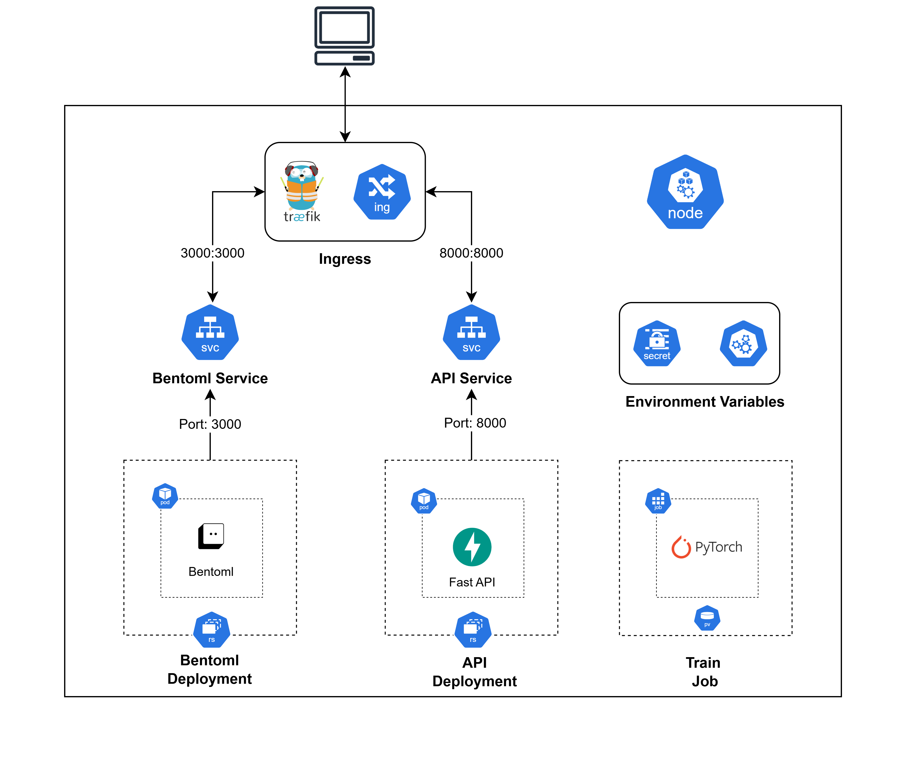

## Architecture
{ align="center" width="80%" }

### Components

- **API Service**: Handles the main API requests.
- **Bentoml Service**: Manages the machine learning model serving.
- **Redis Service**: Provides caching and message brokering for the application.
- **Ingress**: Routes external traffic to the appropriate services and exposes to the client. 
- **Secrets and CofigMaps**: Store sensitive information and configuration data securely.
- **Traefik**: A reverse proxy and load balancer that manages incoming requests and directs them to the appropriate services.
- **Training Job**: A Kubernetes job that handles the training of the models. (currently inactive and isn't tested)
- **Services**: Provides a stable IP to access the pods for Bentoml and API services. 
- **BenomML Pod**: Run through BentoML built cotntainer `galax-bentoml:latest`, that provides inference for the selected model. 
- **API Pod**: Run through FastAPI container, `galax-api:latest`, that provides API endpoints for the application.
- **Deployment**: Manages the lifecycle of the pods, ensuring that the desired number of replicas are running and available.
- **Redis Pod**: Run through Redis container, `redis:latest`, that provides caching and message brokering for the application.
- 
!!! Note
    Both BenotLM and API require: `SQL Database` and `AzureBlob` environment variables. During testing I ran `MySQL` in [Aiven](https://aiven.io). 
    
    BentoML further requires `Mlflow` or any local model set in its cache. 
## Helm Chart
Helm chart is available in `infra/helm/galaxy-classification` directory. 
## Setup
### With Helm

```helm upgrade --install galax \
  ./infra/helm/galaxy-classification \
  --namespace galaxy \
  --create-namespace \
  -f ./infra/helm/galaxy-classification/values.yaml
```

### Configs and Environment Variables

Kubernetes separates runtime configuration into ConfigMaps and sensitive
values into Secrets:

- ConfigMaps store non-sensitive YAML configuration.
- Secrets store database URLs, Azure Storage connection strings, and MLflow credentials.
- Environment variables passed by Deployments and Jobs are available to containers at runtime.

For the complete application-wide variable reference, including local
development defaults, see [Environment variables](../deployment/env-vars.md).

#### ConfigMaps

| ConfigMap | Mounted file | Used by | Purpose |
|---|---|---|---|
| `backend-config` | `/app/configs/backend.yaml` | API and BentoML | Database pool settings, Azure container name, Celery endpoints, environment, debug mode, and BentoML routes. |
| `core-config` | `/app/configs/core.yaml` | BentoML and training containers | Core system settings, directories, logging, and runtime options. |
| `ml-config` | `/app/configs/ml.yaml` | Training and BentoML containers | Model variants, training settings, evaluation settings, and MLflow experiment configuration. |
Apply and inspect the ConfigMaps with:

```bash
kubectl apply -f infra/k8/backend_configmap.yaml
kubectl apply -f infra/k8/core_configmap.yaml
kubectl apply -f infra/k8/ml_configmap.yaml

kubectl get configmap backend-config core-config ml-config
kubectl describe configmap backend-config
```

Update a ConfigMap and restart affected workloads so the mounted configuration
is reloaded:

```bash
kubectl rollout restart deployment api-deployment
kubectl rollout restart deployment bentoml-deployment
kubectl rollout status deployment api-deployment
kubectl rollout status deployment bentoml-deployment
```

#### Container environment variables

| Variable | Required | Source | Used by | Purpose |
|---|---|---|---|---|
| `DATABASE_URL` | Production API | `api-secret` key `DATABASE_URL` | API | SQLAlchemy/Alembic database connection URL. |
| `AZURE_STORAGE_CONNECTION_STRING` | Storage features | `azure-secret` key `AZURE_STORAGE_CONNECTION_STRING`, or `Azure-secrets` key `connection-string` | API, BentoML, training | Azure Blob Storage or Azurite connection string. |
| `MLFLOW_TRACKING_URI` | MLflow features | `mlflow-secrets` key `host` | BentoML, training, init containers | MLflow server URL. |
| `MLFLOW_USERNAME` | Authenticated MLflow | `mlflow-secrets` key `username` | Training, BentoML | Kubernetes-compatible MLflow username. |
| `MLFLOW_PASSWORD` | Authenticated MLflow | `mlflow-secrets` key `password` | Training, BentoML | Kubernetes-compatible MLflow password. |
| `MLFLOW_TRACKING_USERNAME` | Authenticated MLflow HTTP calls | MLflow Secret | Python MLflow clients | Preferred application username variable. |
| `MLFLOW_TRACKING_PASSWORD` | Authenticated MLflow HTTP calls | MLflow Secret | Python MLflow clients | Preferred application password variable. |
| `BENTOML_DEFAULT_URL` | No | `backend-config` or process environment | API worker | Default BentoML classification route. |
| `BENTOML_HUBBLE_URL` | No | `backend-config` or process environment | API worker | Hubble model route. |
| `BENTOML_DIRICHLET_URL` | No | `backend-config` or process environment | API worker | Dirichlet model route. |
| `ML_YAML_PATH` | No | Pod/container setting | BentoML and training | Path to the mounted ML configuration. |
| `CORE_YAML_PATH` | No | Pod/container setting | BentoML and training | Path to the mounted core configuration. |
| `BACKEND_CONFIG_PATH` | No | Pod/container setting | API and BentoML | Path to the mounted backend configuration. |
| `LOG_JSON` | No | Pod/container setting or ConfigMap | API and BentoML | Set to `True` for JSON-formatted container logs. |

!!! note
    Existing manifests use `MLFOW_TRACKING_URI` and `BACKEND_YAML_PATH` in a few
    places. The application variable names are `MLFLOW_TRACKING_URI` and
    `BACKEND_CONFIG_PATH`. The manifest names should be corrected to match the
    application before deployment if they differ from the table above.

### Installing helm

=== "linux"

    ```bash title="install helm"
    chmod +x /infra/k8/get_helm.sh
    /infra/k8/get_helm.sh
    ```
=== "windows"

    ```powershell title="install helm"
    winget install Helm.Helm
    ```

### Installing required charts

```bash title=43`"installing Traefik"
    helm repo add traefik https://traefik.github.io/charts
    helm repo update

    helm install traefik traefik/traefik \
    --namespace traefik \
    --create-namespace

    kubectl get pods -n traefik
```

### Image source in manifests

```yaml hl_lines="3"
containers:
      - name: api
        image: galax-api:v1.0.0
        imagePullPolicy: Never
        ports:
        - containerPort: 8000
        readinessProbe: #check if pod is ready to serve 
          httpGet:
            path: /health
```
Change Image source to pull from my ghcr.io for production deployment.

```yaml title="update"
        image: ghcr.io/yubiknakarmi/galax-api:v1.0.0
        imagePullPolicy: Always
```

### Secrets
This project contains three main secrets `mlflow`, `db` and `AzureBlob`. 

Create the MLflow Secret:

```sh title="create MLflow secret"
kubectl create secret generic mlflow-secrets \
  --from-literal=host=<mlflow-host> \
  --from-literal=username=<mlflow-username> \
  --from-literal=password=<mlflow-password>
```

Create the API database Secret:

```sh title="create database secret"
kubectl create secret generic api-secret \
  --from-literal=DATABASE_URL='<database-url>'
```

Create the Azure Blob Storage Secret:

```sh title="create Azure Storage secret"
kubectl create secret generic azure-secret \
  --from-literal=AZURE_STORAGE_CONNECTION_STRING='<azure-storage-connection-string>'
```

The training and BentoML manifests also use an `Azure-secrets` Secret with a
`connection-string` key:

```sh title="create training Azure secret"
kubectl create secret generic Azure-secrets \
  --from-literal=connection-string='<azure-storage-connection-string>'
```

Verify Secret keys without printing their values:

```sh
kubectl get secret mlflow-secrets api-secret azure-secret Azure-secrets
kubectl describe secret mlflow-secrets
```

Pods require a restart after changing Secret values:
```sh
kubectl rollout restart deployment api-deployment
kubectl rollout restart deployment bentoml-deployment
kubectl delete job MYAPP --ignore-not-found
kubectl apply -f infra/k8/training.yaml
```

!!! Warning
    While creating azure blob secret which contains `;` semicolon use `'` single quotes to avoid issues with shell parsing.


## Running
### Running an API service

```bash title="run api service"
kubectl apply -f infra/k8/api_deploy.yaml
kubectl apply -f infra/k8/api_service.yaml
```

checking pods and services

```bash title="check pods and services"
kubectl get pods
kubectl get services
```

port forwarding to access the API service

```bash title="port forwarding"
kubectl port-forward service/api-service 8000:8000
```

## Furure Additions
Currently I am working on adding LGTM or equivalent stack in kuberentes. 