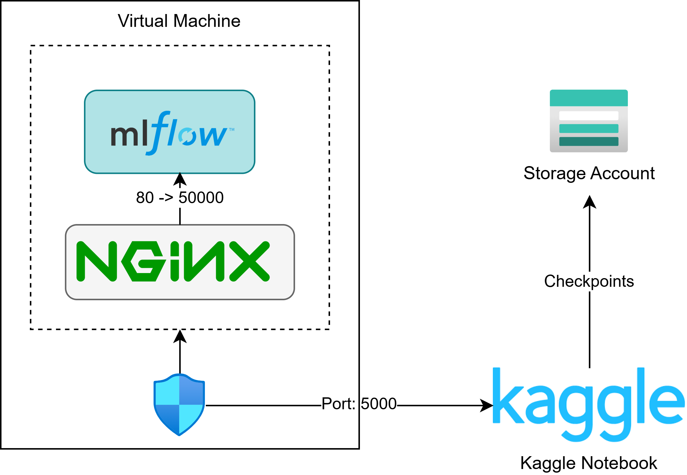

## Architecture Overview


## MLflow VM
I used Azure Bv1as VM to setup the MLflow server. The VM was setup with 2 vCPUs, 4GB RAM and 32GB SSD. The VM was setup with Ubuntu 20.04 LTS. The VM was setup with Docker and Docker Compose. The MLflow server was setup using nginx as a reverse proxy for basic auth and mlflow v3.13.0, both in docker compose. Some general setup in vm are as follows:

## Setup

```bash title="install docker and docker compose"
#install docker compose and nginx
sudo apt-get update
sudo apt-get install -y ca-certificates curl
sudo install -m 0755 -d /etc/apt/keyrings

sudo curl -fsSL https://download.docker.com/linux/ubuntu/gpg -o /etc/apt/keyrings/docker.asc
echo "deb [arch=$(dpkg --print-architecture) signed-by=/etc/apt/keyrings/docker.asc] \
https://download.docker.com/linux/ubuntu $(. /etc/os-release && echo $VERSION_CODENAME) stable" \
  | sudo tee /etc/apt/sources.list.d/docker.list > /dev/null

sudo apt-get update
sudo apt-get install -y docker-ce docker-ce-cli containerd.io docker-compose-plugin apache2-utils

sudo systemctl enable --now docker
sudo usermod -aG docker $USER      # log out and back in to use docker without sudo

# working dir for mlflow
mkdir -p /home/azureuser/mlflow 
mkdir /home/azureuser/mlflow/nginx

cd /home/azureuser/mlflow
```
Now setting up mlflow, we first need to have a object storage and sql db. I used both of these extrnal with Aiven for MYsql db and Azure blob storage for object storage. You can also setup both of these in the same vm, but I recommend using external services for production. The mlflow server was setup with the following docker compose file:

```bash title=".env example"
cat > .env <<'EOF'
MLFLOW_BACKEND_STORE_URI=mysql+pymysql://<username>:<password>@<host>:<port>/<database> #db
MLFLOW_ARTIFACT_ROOT=azure://<container_name>
EOF
```

Now nginx setup for basic auth, 

```bash title="nginx setup"
# create a password file for basic auth
htpasswd -bc /etc/nginx/.htpasswd "$MLFLOW_USER" "$MLFLOW_PASS"
```

```bash title="nginx config"
cat > /etc/nginx/sites-available/mlflow <<'EOF'
server {
    listen 5000;
    client_max_body_size 0;
    proxy_read_timeout 600s;
    location / {
        auth_basic "MLflow";
        auth_basic_user_file /etc/nginx/.htpasswd;
        proxy_pass http://127.0.0.1:5001;
        proxy_set_header Host $host;
    }
}
EOF
```

```bash title="docker-compose.yaml"

cat > docker-compose.yaml <<'EOF'
mlflow:
    image: ghcr.io/mlflow/mlflow:v3.13.0-full
    container_name: mlflow
    ports:
      - "5000:5000"
    env_file:
      - .env
    environment:
        MLFLOW_BACKEND_STORE_URI: ${MLFLOW_BACKEND_STORE_URI}
        MLFLOW_ARTIFACT_ROOT: ${MLFLOW_ARTIFACT_ROOT}
    
    command: >    #mlflow db upgrade \"${MLFLOW_BACKEND_STORE_URI}\" &&
         mlflow server
          --backend-store-uri ${MLFLOW_BACKEND_STORE_URI}
          --default-artifact-root ${MLFLOW_ARTIFACT_ROOT}
          --host 0.0.0.0
          --port 5000
          --allowed-hosts "*"
          --cors-allowed-origins "http://104.211.98.50:5000"
          
    healthcheck:
      test: ["CMD", "python", "-c", "import urllib.request; urllib.request.urlopen('http://localhost:5000/health')"]
      interval: 10s
      timeout: 5s
      retries: 5
      start_period: 10s

    restart: unless-stopped

  nginx:
    image: nginx:stable
    container_name: mlflow-nginx
    ports:
      - "5000:80"         #
    volumes:
      - ./nginx/nginx.conf:/etc/nginx/conf.d/default.conf:ro
      - ./nginx/.htpasswd:/etc/nginx/.htpasswd:ro
    depends_on:
      mlflow:
        condition: service_healthy
    restart: unless-stopped
EOF
```
running it 

```bash title="run mlflow server"
docker compose up -d
docker ps

curl -u $MLFLOW_USER:$MLFLOW_PASS http://localhost:5000/health
```


The full setup script can be found in [infra/mlflow_vm_setup.sh](https://github.com/YubikNakarmi/galaxy-classification/blob/dev/infra/terraform/mlflow_setup.sh).

### Kaggle Notebook
To emulate a VM like environment that this project was developed to, I used jupyter magic commands and also shell escape to setup the codebase. 

