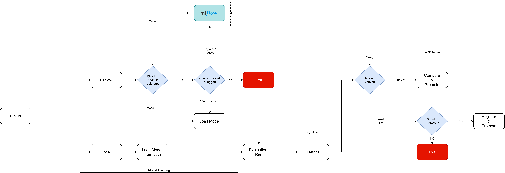

## Architecture
{ align="center" width="100%" }
## Evaluation steps
The evaluation Can be of two modes local or mlflow. 

- **MLflow**- the mlfow mode will pull a registered model form the mlflow registry
- **Local**- the local mode will pull a model from the local path.'

### Mlflow
Mlflow is a central part for the evaluation step as it serves as a central repository for all the regisered models. While the evaluation can run without it I strongly recooomend using  it. 

!!! Note
    You can run the evaluation without requireing model registered using the local mode. 

During the evaluation two possible experiments in mlflow can be created
- **Evaluatoin**- this experiment will be created if the evaluation is run in mlflow mode. The evaluation metrics will be logged to this experiment.
- ** Model registered**- this experiment will be created when a model is registered in mlflow. The model metrics will be logged to this experiment.