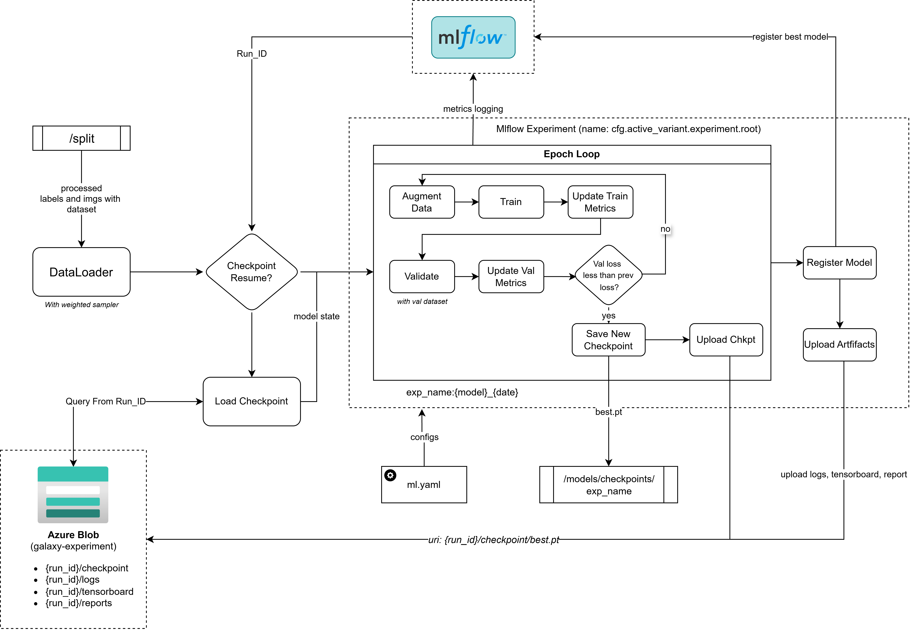

# training factors
| Component | Value | Notes |
|---|---|---|
| Loss | `CrossEntropyLoss` | `label_smoothing=0.1` |
| Optimizer | `AdamW` | `lr=1e-3`, `weight_decay=1e-4`, `betas=(0.9, 0.999)` |
| LR Warmup | Linear, 5–10 epochs | LR rises from ~0 to `1e-3` |
| LR Scheduler | Cosine Annealing | Decays smoothly to ~0 after warmup |
| Epochs | 50–100 | No pretrained weights,|
| Batch Size | 32–64 | Balance gradient quality vs memory |
| Grad Clipping | `clip_grad_norm_` | `max_norm=1.0`, before `optimizer.step()` |

# Architrure

# Customizations
All the training customaizations can be done through the `configs/ml.yaml` file. The following are the main sections of the configuration file:


## Environment Variables

These variables control training behaviour. Set them in your `.env` file or inject via shell / Kaggle Secrets.

| Variable | Config Key | Default | Description |
|---|---|---|---|
| `MLFLOW_TRACKING_URI` | — | `http://localhost:5000` | MLflow server URI for experiment tracking and model registry |
| `AZURE_STORAGE_CONNECTION_STRING` | — | — | Azure Blob Storage connection string for checkpoint and log uploads |
| `AZURE_STORAGE_ACCOUNT_NAME` | — | — | Storage account name (used if connection string not set) |
| `AZURE_STORAGE_ACCOUNT_KEY` | — | — | Storage account key |

## Training Configuration (`configs/ml.yaml`)

| Key | Path in YAML | Default | Description |
|---|---|---|---|
| Active variant | `active_variant` | `default` | Which model variant to train (`default`, `hubble`, `dirichlet`) |
| Device | `env.device` | `cpu` | Compute device (`cpu`, `cuda`, `cuda:0`) |
| Seed | `env.seed` | — | Global random seed for reproducibility |
| Epochs | `train.num_epochs` | — | Total training epochs |
| Batch size | `train.batch_size` | — | Dataloader batch size |
| Learning rate | `train.learning_rate` | — | Initial AdamW learning rate |
| Min LR | `train.scheduler.min_lr` | — | `eta_min` for `CosineAnnealingWarmRestarts` |
| Warmup epochs | `train.scheduler.warmup_epochs` | — | `T_0` for cosine restart period |
| Grad clip | `train.grad_clip_max_norm` | `1.0` | Max norm for gradient clipping |
| Resume checkpoint | `train.checkpoints.resume_from_checkpoint` | `false` | Attempt to resume from a saved checkpoint |
| Hard resume | `train.checkpoints.checkpoint_resume_hard` | `false` | Exit if no checkpoint found (vs. start fresh) |
| Checkpoint blob path | `train.checkpoints.checkpoint_restore_path` | — | Azure blob path to download resume checkpoint from |
| Local checkpoint dir | `train.checkpoints.local_checkpoint_path` | — | Local path for checkpoint download before resume |
| Image dir | `data.img_dir` | — | Root directory of galaxy images |
| Train CSV | `data.train_path` | — | Path to train split label CSV |
| Val CSV | `data.val_path` | — | Path to val split label CSV |
| Checkpoint container | `storage.cloud.experiments.container` | — | Azure container name for experiment checkpoints |
| Logs container | `logging.cloud.logs.container` | — | Azure container name for training logs and reports |
| Tensorboard dir | `storage.local.logs.tensorboard_dir` | — | Local directory for TensorBoard event files |
| Reports dir | `storage.local.logs.reports_dir` | — | Local directory for markdown training reports |
| Num classes | `variants.<active>.num_classes` | `6` | Number of output classes for the active variant |
| MLflow model name | `variants.<active>.mlflow.model_name` | — | Registered model name in MLflow |
| Experiment root | `variants.<active>.experiment.root` | — | Top-level MLflow experiment name |

# Traininng Flow


## checkpoints
- eval checkpoints
- training epoch based checkpoints

## visualizations
- Mlflow and tensorboard, and reports functions

## Training options

### Default
    Default model variant with standard training settings. With 5 classes and using default model

### Hubble
    Model variant optimized for Hubble Space Telescope images., with 10 hubble classes and defautl model.

### Dirilichet
    Model variant tailored for Dirilichet telescope images. With 10 dirilichet classes and dirilcihlet model.

## Default training model

### Experiments
Each training run should log its own experiment name with ```{time}_{model_variant}```
