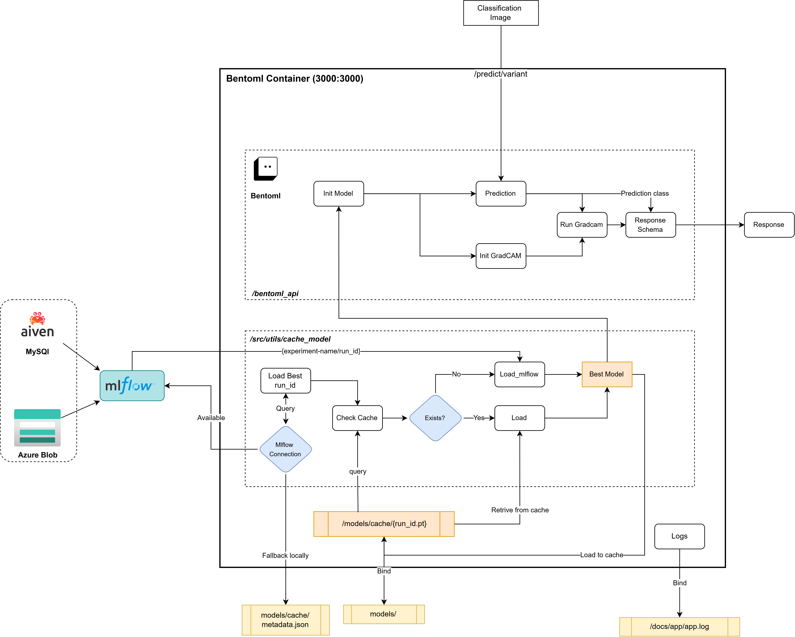

# Setup

## Endpionts

### `/default`

## Build & Containerize
Firstly build the bentoml service using using the following command:

``` bash
bentoml build --version 0.6.0 --containerize

```
or 
``` bash
source(./setup.sh && bentoml_build)
```
## Response

``` json


```

## Run the service
Once the service is built, you can run it using the following commannd in the docker compose: 

``` bash
docker compose up bentoml
```

!!! warning "Make sure to run the bentoml service first"
    The bentoml service should be running before the api service is started. This is because the api service depends on the bentoml service to load the model and run inference. If the bentoml service is not running, the api service will fail to start.


# Structure
I used service and runner structure that seperates the model loading and inference from the main service. This is done to make the code more modular and easier to maintain. The service is responsible for handling the requests and responses, while the runner is responsible for loading the model and running the inference. This structure also allows for easy scaling of the service by adding more runners as needed.



## Services

### Galaxy Classification Service


## Sending Request

``` bash title="Request"
curl -X 'POST' \
  'http://localhost:3000/default' \
  -H 'accept: application/json' \
  -H 'Content-Type: multipart/form-data' \
  -F 'images=@3.jpg;type=image/jpeg'
  ```


  ``` json title="Response"
  [
  {
    "object_type": "edge_on",
    "confidence_scores": 0.8165369033813477,
    "heatmap_b64": "iVBORw0KGgoAAAANSUhEUgAAAIAAAACACAIAAABMXPacAABRzUlEQVR4nG393.........",
    "heatmap_latency": 1.4109894009999948
  }
]

``` python title="Request"
import requests

```

## Logging

You can remove json logs in contair by removing this line which intecetps stdlib, and set json_logs to False in the core.yaml file. This will make the logs more readable and easier to debug.
``` python title="bentoml_api/service.py" hl_lines="5 6"
file_config = root / 'configs' / 'core.yaml'
log_yaml = load_yaml(file_config)
log_json = os.getenv("LOG_JSON", "True").lower() in ("true", "1", "yes")

setup_app_logging(log_yaml,service = "Bentoml",json_logs = True)
intercept_stdlib_logging() # logs stdlib to loguru in container logs

```
---
## Improvements


!!! info "Future Improvements"
    - Adding backup to cache to pull model from azure blob if mlflow is down. This will make the service more robust and reliable.
    - Using a more robust model loading mechanism that can handle different model formats and versions. This will make the service more flexible and easier to maintain.
